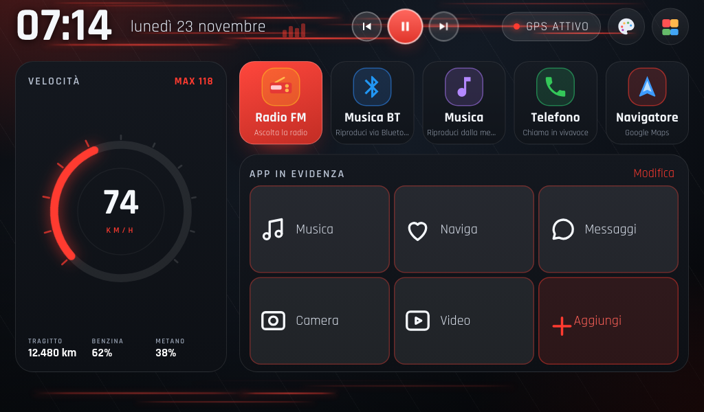
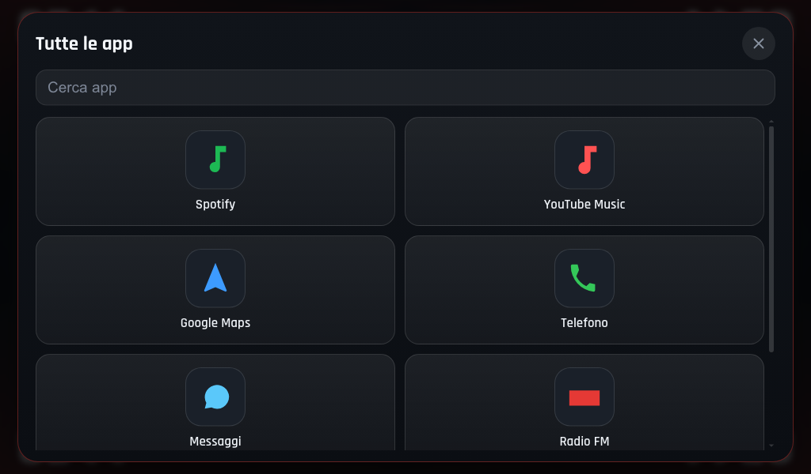
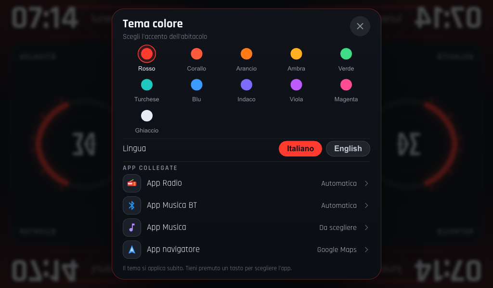

# Car Launcher CP

Launcher per autoradio Android: un'unica schermata "da plancia" con velocità GPS,
radio FM, due scorciatoie musicali, telefono, navigatore, app in evidenza e tema
colore selezionabile. Il tema predefinito è il rosso, ma l'accento dell'interfaccia
si cambia al volo. Testi grandi e icone colorate, pensati per essere letti mentre
si guida.



## Funzioni

- **Velocità oraria** — tachimetro circolare con velocità GPS in km/h, velocità massima
  raggiunta e stato del fix (`GPS ATTIVO` / `CERCO GPS` / `GPS OFF`). A macchina ferma il
  valore resta esattamente **0**: le oscillazioni del GPS fino a **3 km/h** vengono
  filtrate con una soglia di fermo e un'isteresi, e se il fix sparisce la velocità non
  resta congelata sull'ultimo valore.
- **Dati dall'auto (CAN)** — se l'autoradio ha il modulo CAN, sotto al tachimetro compaiono i
  **chilometri del tragitto** (o i chilometri totali se il tragitto non è disponibile) e il
  livello di **benzina** e **metano** quando il veicolo li espone. La riga resta nascosta sulle
  autoradio che non trasmettono questi dati: nessun numero inventato.
- **Radio FM** — apre l'app radio del tuo autoradio: viene cercata automaticamente fra i
  pacchetti più diffusi, altrimenti la scegli tu e la scelta viene ricordata.
- **Musica BT** — apre la musica in streaming dal Bluetooth (app di sistema o quella che
  preferisci).
- **Musica** — la cartella della musica sul dispositivo, con un'app scelta liberamente:
  utile per esempio per avere Spotify su un tasto e la musica dalla memoria sull'altro.
  L'ordine dei tasti è Radio, Musica BT, Musica, Telefono, Navigatore.
- **Telefono** — apre il dialer per chiamare in vivavoce.
- **Navigatore** — apre l'app di navigazione scelta fra quelle installate sul sistema
  (Google Maps, Waze, Here, TomTom, Sygic, OsmAnd, Yandex, iGO e altre). Se non ne è
  stata scelta una viene rilevata automaticamente; la scelta resta memorizzata.
- **App in evidenza** — fino a 6 scorciatoie scelte da te. Tieni premuta una scorciatoia
  per sostituirla o rimuoverla.
- **Orologio e data** — ora bianca molto grande con accanto la data per esteso, per
  esempio `domenica 22 novembre`, e subito dopo le barre dell'equalizzatore, che si muovono
  **solo mentre qualcosa sta suonando** e restano ferme a volume spento.
  Dietro l'orologio salgono sottili linee colorate, su una banda che resta alta quanto
  l'intestazione; la stessa animazione chiude l'interfaccia in basso, in una striscia
  sottile a filo schermo, così il corpo centrale ha più spazio.
- **Tutte le app** — il tasto in alto a destra apre una griglia a due colonne che occupa
  quasi tutto lo schermo: celle grandi, icona e nome leggibili, ricerca con filtro anche
  sulle lettere accentate. Tocco sull'icona = app a tutto schermo.
- **Comandi musicali** — i tre comandi in alto (`‹` indietro, pausa/riproduci, `›` avanti)
  mandano i tasti multimediali di sistema all'app che sta suonando in quel momento: pausa e
  cambio traccia funzionano con qualunque player (radio FM, Spotify, YouTube Music, podcast)
  senza aprire l'app. I tasti hanno un contorno marcato che li stacca dallo sfondo anche in
  trasparenza; su schermi stretti scendono su una riga sotto l'orologio.
- **Tema colore** — 11 accenti (Rosso, Corallo, Arancio, Ambra, Verde, Turchese, Blu,
  Indaco, Viola, Magenta, Ghiaccio). Il colore viene applicato a sfondo, tachimetro,
  bordi e card, e resta memorizzato.
- **Lingua** — interfaccia in **italiano** o **inglese**, scelta dal pannello del tema
  (riga `Lingua`). Anche date e dialoghi seguono la lingua scelta.
- **Tasti quadrati** — cinque tasti di pari dimensioni (Radio, Musica BT, Musica,
  Telefono, Navigatore) disposti in fila su schermo orizzontale e in griglia su verticale,
  con icone grandi e ognuna sulla propria placca colorata. Anche le app in evidenza hanno
  icone più grandi, mentre la loro card è un po' più compatta per lasciare spazio ai tasti.

Tieni premuto un tasto (Radio, Musica BT, Musica, Navigatore) per cambiare l'app collegata
senza passare dal pannello delle impostazioni.





## Installazione

1. Scarica `CarLauncherCP-1.7.0.apk` dalla sezione **Releases**.
2. Copiala sul dispositivo (chiavetta USB, ADB, ecc.) e installala, abilitando
   l'installazione da origini sconosciute se richiesto.
3. Al primo avvio concede il permesso **Posizione** (serve solo per la velocità GPS).
   Se lo neghi, il launcher funziona lo stesso e il tachimetro mostra `--`.
4. Per usarlo come home: **Impostazioni → App → App predefinite → Home → Car Launcher CP**.
   L'activity dichiara già il category `HOME`, quindi compare fra i launcher disponibili.

L'APK nella release è firmato con la chiave di debug del progetto: va bene per il
sideload sul proprio autoradio, non per la pubblicazione su Play Store. Per una
firma tua crea un keystore e un file `keystore.properties` nella radice del progetto
(entrambi esclusi da git):

```properties
storeFile=/percorso/release.jks
storePassword=...
keyAlias=...
keyPassword=...
```

## Costruzione

Requisiti: JDK 17, Android SDK con platform 34 e build-tools 34.

```bash
./gradlew assembleDebug    # APK di debug
./gradlew assembleRelease  # APK di release
```

Gli APK finiscono in `app/build/outputs/apk/`.

## Anteprima del design

`preview/index.html` è una riproduzione statica dell'interfaccia (HTML/CSS, font
Rajdhani) utile per provare i colori senza installare l'app: si apre direttamente
nel browser, senza build. Non fa parte dell'APK.

## Struttura

```
app/src/main/java/com/carlaunchercp/
  MainActivity.java      schermata principale e layout a tasti quadrati
  SpeedGaugeView.java    tachimetro disegnato su Canvas
  Speedometer.java       velocità GPS filtrata (fermo, isteresi, fix scaduto)
  CanBusReader.java      km e carburanti dal CAN dell'autoradio (broadcast e proprietà)
  TileView.java          tasto quadrato (icona colorata, titolo, sottotitolo)
  EqualizerBarsView.java barre animate accanto a orologio e data
  SmokeView.java         linee sottili animate dietro l'orologio e in basso
  MediaKeys.java         pausa e cambio traccia per l'app che sta suonando
  ThemePanel.java        pannello tema, lingua e app collegate
  AppPickerDialog.java   elenco app con ricerca (scelta app dei tasti)
  AllAppsDialog.java     griglia "Tutte le app" a due colonne a tutto schermo
  LauncherActions.java   intent per radio, musica, telefono, navigazione
  ThemePalette.java      palette degli accenti
  LocaleHelper.java      applicazione della lingua italiana/inglese
  Prefs.java             preferenze
  Ui.java                helper di stile
  CarBackgroundView.java sfondo con bagliori dell'accento
app/src/main/res/values/    testi inglesi
app/src/main/res/values-it/ testi italiani
```
